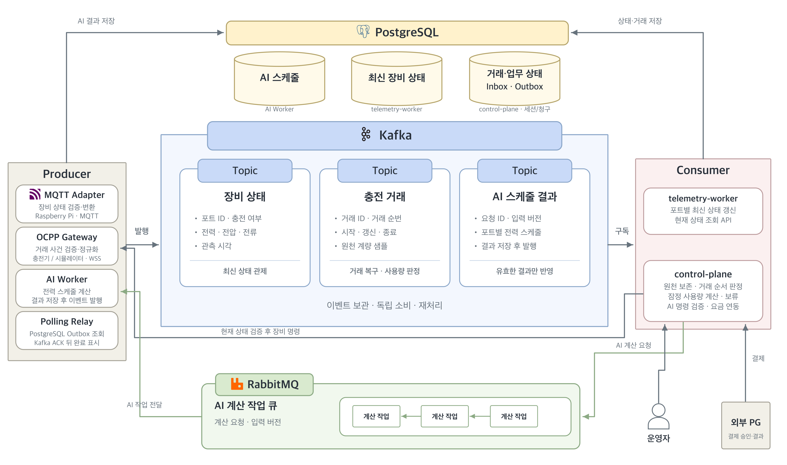

# EV Charging Orchestrator

### 대용량 트래픽과 실시간 충전 데이터 처리를 고려한 전기차 충전 관제 서비스

충전기에서 발생하는 상태·계량·거래 데이터를 수집하고, 운영자에게 충전 포트별 최신 상태를 제공하는 백엔드 서비스입니다.

MQTT 테스트베드와 OCPP 2.0.1 수신 경로를 분리하고, Kafka를 중심으로 장비 연결·상태 처리·거래 처리·운영자 조회를 연결했습니다.

## 기술 스택

| 영역 | 기술 |
|---|---|
| Language & Framework | Java 21, Spring Boot 4.1.1 |
| Device Protocol | MQTT, OCPP 2.0.1 over WSS |
| Messaging | Apache Kafka 4.1.1, Spring Kafka |
| Database | PostgreSQL 18.3, Spring JDBC |
| Migration | Flyway |
| Internal API | HTTPS, Java HttpClient |
| Build & Local Environment | Gradle, Docker Compose |
| Test | JUnit, Testcontainers, Embedded Kafka, Embedded PostgreSQL |

## 전체 아키텍처



MQTT/OCPP 입력, Kafka 이벤트 처리, PostgreSQL 저장, AI 계산 작업과 제어를 연결하는 전체 설계도입니다.

## MSA 관점의 서비스 구성

장비 연결, 이벤트 처리, 운영자 요청은 처리 목적과 부하 특성이 다릅니다. 각 책임을 별도 Spring Boot 앱으로 나누고, Kafka 이벤트와 내부 HTTPS API로 연결했습니다.

| 서비스 | 담당 책임 |
|---|---|
| `mqtt-adapter` | MQTT 연결·구독·재연결, 장비 입력 검증·변환, Kafka 발행 |
| `ocpp-gateway` | OCPP WSS 연결·인증, 거래 메시지 검증, 원천 거래 정보의 Kafka 전달 |
| `telemetry-worker` | 상태 이벤트 소비, 충전 포트별 최신 상태 저장, 내부 조회 API |
| `control-plane` | 운영자 API, 최신 상태 조회 연계, 거래 이벤트 저장·판정 |

### 책임에 따른 실행 단위 분리

장비 연결과 프로토콜 처리는 Adapter·Gateway가 담당하고, 최신 상태 갱신은 Telemetry Worker가 담당합니다. 운영자 요청과 거래 업무 처리는 Control Plane에서 다룹니다.

각 앱은 독립된 실행 진입점을 가지며, 하나의 저장소와 Gradle 멀티모듈 구조에서 관리합니다. 앱 사이에 직접적인 Gradle 의존성을 두지 않고 공통 이벤트 계약 모듈을 공유합니다.

### 이벤트 전달과 조회 통신

| 통신 | 방식 | 용도 |
|---|---|---|
| MQTT Adapter → Telemetry Worker | Kafka | 상태·계량 이벤트 전달 |
| OCPP Gateway → Control Plane | Kafka | 충전 거래 이벤트 전달 |
| Control Plane → Telemetry Worker | 내부 HTTPS | 운영자 요청에 필요한 최신 상태 조회 |

이벤트 수신과 소비를 분리해 각 앱이 자신의 처리 책임을 수행하도록 구성했습니다. 운영자 조회는 내부 HTTPS API를 통해 저장된 최신 상태를 읽습니다.

### 상태와 거래의 데이터 소유권

`telemetry-worker`는 충전 포트별 최신 상태를 저장하고 조회 API를 제공합니다. `control-plane`은 해당 상태 테이블을 직접 조회하는 대신 내부 API를 호출하며, 거래 원천과 판정 상태를 관리합니다.

상태 이벤트에는 최신 관측을 반영하는 규칙을 적용하고, 거래 이벤트에는 거래 ID·순번·원천 계량 정보를 보존하는 별도 계약을 적용합니다. 두 데이터는 Kafka 토픽과 소비 경로를 구분해 처리합니다.

## 주요 기능

| 기능 | 설명 |
|---|---|
| 장비 상태 수집 | MQTT로 충전 여부·전력·전압·전류를 수집하고 내부 이벤트로 변환 |
| 최신 상태 관리 | 충전소·EVSE별 최신 관측을 PostgreSQL에 저장 |
| 운영자 상태 조회 | 충전소별 포트 목록과 개별 포트의 최신 상태 조회 |
| 충전 거래 수집 | OCPP `TransactionEvent`를 검증하고 거래 전용 Kafka 토픽으로 전달 |
| 거래 데이터 처리 | 거래 식별자·순번·원천 계량 정보를 보존하고 거래 상태 판정 |

## 프로젝트 구조

```text
apps/
├── mqtt-adapter        # MQTT 수신·변환·Kafka 발행
├── ocpp-gateway        # OCPP WSS 연결·거래 수신
├── telemetry-worker    # 상태 소비·저장·내부 조회
├── control-plane       # 운영자 API·거래 처리
├── ai-worker           # AI Worker 실행 모듈
└── charger-simulator   # 충전기 시뮬레이터 실행 모듈

modules/
├── messaging-contract  # 공통 이벤트 계약·식별자·검증
├── charging-domain     # 공통 도메인 모듈
└── test-support        # 공통 테스트 지원 모듈

infra/                  # 로컬 PostgreSQL·MQTT 설정
load-tests/             # 부하 실험 구성
scripts/                # 로컬 TLS 자료 생성
```

## 로컬 실행

Java 21, Docker, Python 3가 필요합니다.

### 1. 환경 설정과 인프라 실행

`.env.example`을 복사한 뒤, DB 관리자·앱 계정 비밀번호를 서로 다른 값으로 설정합니다.

```sh
cp .env.example .env

python3 scripts/create-local-telemetry-tls.py

docker compose up -d --wait postgres kafka mosquitto
docker compose run --rm kafka-init
```

`.env`와 생성된 인증 자료는 Git에서 제외합니다.

### 2. 상태 관제 앱 실행

프로젝트 루트의 별도 터미널에서 각 앱을 실행합니다.

```sh
./gradlew :apps:telemetry-worker:bootRun \
  --args='--spring.profiles.active=local'
```

```sh
./gradlew :apps:mqtt-adapter:bootRun \
  --args='--spring.profiles.active=local'
```

```sh
./gradlew :apps:control-plane:bootRun \
  --args='--spring.profiles.active=local'
```

### 3. 운영자 상태 조회

MQTT 상태 입력 이후 저장된 최신 관측을 조회합니다. `SIM001`은 입력에 사용한 충전소 ID로 바꿉니다.

```sh
curl http://127.0.0.1:18580/api/v1/stations/SIM001/telemetry/latest
```

| API | 설명 |
|---|---|
| `GET /api/v1/stations/{stationId}/telemetry/latest` | 충전소의 포트별 최신 상태 목록 |
| `GET /api/v1/stations/{stationId}/evses/{evseId}/telemetry/latest` | 특정 포트의 최신 상태 |

### 4. 테스트

```sh
./gradlew test
```

통합 테스트를 실행하려면 Docker가 실행 중이어야 합니다.
